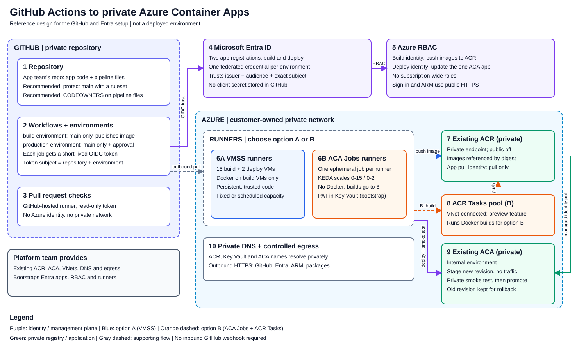

# GitHub Actions to private Azure Container Apps
## GitHub and Microsoft Entra setup guide

**Audience:** platform and DevOps engineers. **Baseline:** November 2026; confirm details against current vendor docs.
**Example workload:** hello-world HTTP app, 200 builds/day, bursts of 10-15 concurrent builds.

This guide shows how to configure **GitHub, Microsoft Entra ID, and self-hosted runners** so a GitHub repository can build an image,
push it to a **private Azure Container Registry (ACR)**, and deploy it to an **existing private Azure Container App (ACA)**
without storing any Azure password in GitHub.

> **Scope.** The ACR, the ACA environment/app, the VNets, and DNS are supplied by your platform team. This guide lists what
> they must provide and the few settings the pipeline depends on, but it does not create them. Commands are examples:
> replace every `<PLACEHOLDER>` and follow your change process. Nothing in this package has been deployed to Azure.

## Contents

1. [How it fits together](#1-how-it-fits-together)
2. [Choose a runner option](#2-choose-a-runner-option)
3. [Before you start](#3-before-you-start)
4. [Step 1: Configure GitHub](#4-step-1-configure-github)
5. [Step 2: Decide the OIDC subjects](#5-step-2-decide-the-oidc-subjects)
6. [Step 3: Create the Entra identities and roles](#6-step-3-create-the-entra-identities-and-roles)
7. [Step 4: Set up the runners](#7-step-4-set-up-the-runners)
8. [Step 5: Add the workflows and release](#8-step-5-add-the-workflows-and-release)
9. [Verify](#9-verify)
10. [Troubleshooting](#10-troubleshooting)
11. [Security notes and what is not covered](#11-security-notes-and-what-is-not-covered)
12. [Files and sources](#12-files-and-sources)

## 1. How it fits together



Editable version: [architecture.drawio](assets/architecture.drawio) (open in diagrams.net). Keep the `assets` folder next to this file.

| # | Piece | What it does |
|---|---|---|
| 1 | **Repository** | The application team's private repo, holding the app code and the pipeline files. Recommended: a ruleset on `main` and CODEOWNERS on the pipeline files, because whoever can change a deployment workflow can use its Azure access. |
| 2 | **Workflows + environments** | Two GitHub environments, `build` and `production`. Each job receives a short-lived **OIDC token** whose *subject* names the repo and environment. `production` requires a reviewer. |
| 3 | **Pull request checks** | Run on GitHub-hosted runners with a read-only token. They never see Azure credentials or your private network. |
| 4 | **Microsoft Entra ID** | Two app registrations (build, deploy). Each has a **federated credential** that trusts one exact GitHub subject. No client secret exists. |
| 5 | **Azure RBAC** | Build identity can push to ACR. Deploy identity can update only the one ACA app. |
| 6 | **Runners** | Self-hosted runners inside your network so jobs can reach the private ACR and ACA. Option A: VMSS. Option B: ACA Jobs. |
| 7 | **ACR** | Private endpoint, public access off. Deployments reference images by immutable digest. |
| 8 | **ACR Tasks pool** | Option B only. A VNet-connected pool that runs Docker builds, because ACA Jobs cannot run Docker. |
| 9 | **ACA app** | Internal environment. Each release creates a new revision with no traffic, smoke-tests it privately, then promotes it. |
| 10 | **DNS + egress** | Private names must resolve from every runner. Runners need outbound HTTPS to GitHub, Entra, and Azure. |

**What a release does**

1. A merge to `main` starts the `build` job on a build runner. It runs tests, signs in to Azure with OIDC, builds, pushes a unique tag, and records the image **digest**.
2. The `production` job waits for approval.
3. After approval, a deploy runner confirms the commit is still the head of `main`, signs in with the deploy identity, and creates a new ACA revision with **0% traffic**.
4. The script smoke-tests the new revision's private URL and checks that `/health` reports the expected commit.
5. It shifts 100% of traffic to the new revision and re-tests. On failure it restores the previous revision.
6. A separate approved **rollback** workflow can re-activate any earlier revision without rebuilding.

> Azure sign-in, Azure Resource Manager, and GitHub are **public HTTPS** endpoints. Private endpoints protect the registry and app data paths, not those.

## 2. Choose a runner option

The pipeline works with either option. The choice mainly depends on whether you need Docker on the runner and how much you want to operate.

| Question | **A. VMSS runners** | **B. ACA Jobs runners** |
|---|---|---|
| Standard `docker build` and `push` | Yes, on the build VMs | **No.** Builds go to an ACR Tasks agent pool |
| Docker-based actions, `container:`, `services:` | Supported | Not supported |
| Runner lifecycle | **Persistent**; you provision and register VMs | **Ephemeral**; one job per runner, then removed |
| Scale to zero, queue-based scaling | No; fixed or scheduled capacity | Yes (KEDA polls the GitHub queue) |
| Preview dependency | None | ACR Tasks dedicated agent pools are **preview** |
| Bootstrap credential | One-hour registration token, used once by an operator | Repository-scoped GitHub PAT in Key Vault (rotate it) |
| You operate | VM patching, image refresh, runner registration, disk cleanup | Runner image refresh, PAT rotation, the ACR agent pool |
| Best for | Trusted Docker builds with no preview services | Non-Docker steps, deploys, or teams that accept the remote-build preview |

**Recommendation:** start with **A** for builds because it supports ordinary Docker workflows and has no preview dependency.
Use **B** for the deploy job only if you want ephemeral runners there (the *hybrid* pattern: VMSS build, ACA Jobs deploy).

**Neither option makes untrusted code safe.** Persistent runners must only run reviewed code from a private repository.
Pull requests from forks and unreviewed branches must stay on GitHub-hosted runners.

### Indicative monthly cost

Illustrative East US pay-as-you-go list prices, 200 builds/day at about 10 minutes each. Pricing varies by contract; use the Azure calculator for a quote.

| Pattern | Approximate compute |
|---|---|
| A: 15 build + 2 deploy VMs (D2as v5), online 24x7 | **~$1,070** |
| A: same VMs, deallocated outside 220 business hours | **~$320** |
| B: ACA Jobs runner containers only | **~$120** |
| Hybrid: VMSS builds + ACA Jobs deploy | VMSS build cost + ~$11 |

The option B figure covers the runner containers only. It **excludes the ACR Tasks dedicated agent pool**, which is a preview feature billed for allocated capacity
whether or not it is building, and 15 agents run continuously unless you scale the pool down. No price is given here; get a quote for the pool before comparing option B with option A.
Option B's runner containers are cheap, but the always-allocated build pool is not. Add OS disks, NAT/egress, private endpoints, logging, and any new shared network services.
Confirm what "200 executions" means (builds, jobs, or workflows with fan-out) before sizing.

## 3. Before you start

### Who does what

This guide assumes two teams. The **application team** owns the repository, the app code, and its protection settings.
The **deployment team** (the people following this guide) sets up the pipeline, Entra identities, runners, and the Azure side.
Some steps touch both, so agree on these hand-offs early:

| Hand-off | From | To |
|---|---|---|
| Repository name, and repository admin rights (or an admin who performs [section 4.2 and 4.3](#42-create-the-two-environments)) | Application team | Deployment team |
| Pull request review and merge of the pipeline files from [section 8](#8-step-5-add-the-workflows-and-release) | Application team | Deployment team |
| Reviewers for the `production` environment | Application and release owners | Deployment team |
| Repository protection settings in [section 4.1](#41-repository-protection-recommended-owned-by-the-application-team) | Application team | Their own decision |
| Client IDs, tenant ID and subscription ID | Deployment team | Application team (as environment variables) |

### Inputs from the platform team

| Input | Requirement |
|---|---|
| GitHub org and repository | The application team's private repository; default branch `main`. Someone must be able to create environments and variables in it |
| Azure tenant and subscription | Exact GUIDs |
| ACR | Premium; private endpoint; admin account disabled. Note its authorization mode (**RBAC** or **ABAC**) |
| ACA app and environment | Internal environment, existing app name and resource group; sample port `8080` |
| Network | CI subnets that can reach the ACR and ACA private addresses; explicit outbound path (NAT or firewall) |
| Operator access | A private admin host or VPN with Azure CLI and GitHub CLI. Public Cloud Shell cannot reach private endpoints |
| Your permissions | Create Entra app registrations; create role assignments at the ACR and ACA scopes; create environments and variables in the repo (or ask an admin) |
| Quotas | VM vCPUs (A) or ACA Jobs and ACR Tasks cores (B) |

### DNS must work from every runner

Resolve these from an actual runner or the admin host, and expect **private** addresses:

```bash
getent ahostsv4 "<ACR_LOGIN_SERVER>"
getent ahostsv4 "<ACR_REGIONAL_DATA_HOST_FROM_PE_DNS_CONFIG>"
getent ahostsv4 "<ACA_APP_FQDN>"
```

* ACR needs the `privatelink.azurecr.io` zone, including the **regional data endpoint** records.
* An internal ACA environment needs a private DNS zone named exactly its `defaultDomain`, with `*` and `@` A records pointing at its `staticIp`.
* Linking a VNet to a private zone is separate from peering. Link the zones to every VNet that needs them.

### ACA app settings the deploy script depends on

Ask the platform owner to confirm these on the **existing** app (do not run against an unidentified production app):

```bash
az containerapp ingress enable --name "<ACA_APP>" --resource-group "<ACA_RG>" \
  --type external --target-port 8080 --transport auto --allow-insecure false
az containerapp revision set-mode --name "<ACA_APP>" --resource-group "<ACA_RG>" --mode multiple
current=$(az containerapp show --name "<ACA_APP>" --resource-group "<ACA_RG>" \
  --query properties.latestReadyRevisionName -o tsv)
az containerapp ingress traffic set --name "<ACA_APP>" --resource-group "<ACA_RG>" \
  --revision-weight "$current=100"
```

* The environment must already be **internal**. App-level `external` ingress on an internal environment is reachable only through your private network.
  Stop if the environment is publicly reachable.
* The script requires **multiple-revision mode** and exactly **one named revision at 100%** (not `latestRevision`, not a split).
* Configure HTTP startup/readiness probes on `/health`, port `8080`.
* The app needs its own **runtime managed identity** with pull-only access to ACR (see [section 6](#6-step-3-create-the-entra-identities-and-roles)).

## 4. Step 1: Configure GitHub

### 4.1 Repository protection (recommended; owned by the application team)

The repository holds the application code and the pipeline files, and it belongs to the **application team**.
The team that builds the deployment pieces does not need to own these settings, so treat this section as
**recommendations to review with the application team**, not required steps. The pipeline works without them.
They matter because anyone who can change a workflow or script on `main` can use the Azure access that the pipeline is granted.

| Recommendation | Where | Why |
|---|---|---|
| Protect `main` with a ruleset: pull request and at least one reviewer, block force pushes and deletion | Settings > Rules > Rulesets | Only reviewed code reaches the trusted pipeline |
| Add CODEOWNERS for the pipeline files, so a named group reviews changes to them | `CODEOWNERS` file | Pipeline changes get a second look, even from people who can merge app code |
| Allow only approved actions, pin them to full commit SHAs, set the default `GITHUB_TOKEN` to **read-only**, and do not let Actions approve pull requests | Settings > Actions > General | Limits the supply-chain and token risk |
| Keep fork and unreviewed pull-request code off self-hosted runners; never use `pull_request_target` to check out PR code | Workflow design | Self-hosted runners can reach your private network |
| Enable secret scanning and push protection where licensed | Settings > Code security | Catches committed credentials |

Example `CODEOWNERS`, naming whichever group the customer chooses:

```text
/.github/ @contoso/pipeline-owners
/scripts/ @contoso/pipeline-owners
/runner/ @contoso/pipeline-owners
/Dockerfile @contoso/pipeline-owners
```

The one control that is **not** optional is the `production` environment's required reviewers in [section 4.2](#42-create-the-two-environments).
The deploy identity trusts the environment, so its protection rules are what gate production.

### 4.2 Create the two environments

**Settings > Environments > New environment.** Use these exact, lowercase names.

| Environment | Deployment branches | Protection |
|---|---|---|
| `build` | Selected branch `main` only | None needed |
| `production` | Selected branch `main` only; no tags | **Required reviewers**; prevent self-review; no admin bypass where available |

Do not drop the approval requirement if your plan lacks the feature. Upgrade, or add an approved equivalent release gate.
Approval is not a substitute for reviewed workflow changes (see [section 4.1](#41-repository-protection-recommended-owned-by-the-application-team)).

### 4.3 Set variables

There are **no Azure secrets** to add. Client, tenant, and subscription IDs are identifiers, not credentials.
Never create `AZURE_CLIENT_SECRET`, `AZURE_CREDENTIALS`, or an ACR admin password.

**Environment variables** (Settings > Environments > *name* > Environment variables):

| Name | `build` | `production` |
|---|---|---|
| `AZURE_CLIENT_ID` | Build app's client ID | Deploy app's client ID |
| `AZURE_TENANT_ID` | Tenant GUID | Tenant GUID |
| `AZURE_SUBSCRIPTION_ID` | Subscription GUID | Subscription GUID |
| `ACR_NAME` | Registry name (no DNS suffix) | |
| `ACR_LOGIN_SERVER` | e.g. `acmeprod.azurecr.io` | Same value |
| `IMAGE_REPOSITORY` | `apps/hello` | `apps/hello` |
| `BUILD_MODE` | `vmss` or `acr-task` | |
| `ACR_AGENT_POOL` | `privatebuild` (option B only) | |
| `ACA_APP` | | Existing app name |
| `ACA_RESOURCE_GROUP` | | Existing app's resource group |

**Repository variables** (Settings > Secrets and variables > Actions > Variables). Runner labels must be repository-level because they are needed when GitHub schedules the job. Use valid JSON arrays:

| Name | Option A | Option B |
|---|---|---|
| `BUILD_RUNNER_LABELS` | `["self-hosted","linux","x64","aca-build-vmss"]` | `["self-hosted","linux","x64","aca-build-job"]` |
| `DEPLOY_RUNNER_LABELS` | `["self-hosted","linux","x64","aca-deploy-vmss"]` | `["self-hosted","linux","x64","aca-deploy-job"]` |

For the hybrid pattern, use the A build labels, `BUILD_MODE=vmss`, and the B deploy labels.

```bash
gh variable set AZURE_CLIENT_ID --repo contoso/aca-hello --env build --body "<BUILD_CLIENT_ID>"
gh variable set AZURE_CLIENT_ID --repo contoso/aca-hello --env production --body "<DEPLOY_CLIENT_ID>"
gh variable set BUILD_RUNNER_LABELS --repo contoso/aca-hello \
  --body '["self-hosted","linux","x64","aca-build-vmss"]'
```

Set every variable in the tables, not only these examples. The two client IDs come from [step 3](#6-step-3-create-the-entra-identities-and-roles); you can set them afterwards.

## 5. Step 2: Decide the OIDC subjects

Entra issues a token only when the GitHub token's `iss`, `aud`, and **exact `sub`** match a federated credential.
For a job that uses an environment, the subject is normally:

| Credential | Subject |
|---|---|
| Build | `repo:<GITHUB_OWNER>/<GITHUB_REPOSITORY_NAME>:environment:build` |
| Production | `repo:<GITHUB_OWNER>/<GITHUB_REPOSITORY_NAME>:environment:production` |

Environment names are case-sensitive. The Entra portal builds this value for you: choose scenario **GitHub Actions deploying Azure resources**,
enter the organization, repository, entity type **Environment**, and the environment name (see [section 6.1](#61-app-registrations-and-federated-credentials)).
Never widen a subject to all branches, all environments, or the whole organization.

**Only if the first Azure login fails** with `AADSTS70021` (no matching federated credential) is the subject format likely different.
GitHub can use immutable owner and repository IDs, or the organization may use a custom subject template, and a repository rename or transfer changes the value.
To see exactly what GitHub sends, run the optional helper:

1. Merge [oidc-inspect.yml](samples/.github/workflows/oidc-inspect.yml) to `main` through a pull request.
2. **Actions > Inspect OIDC trust subjects > Run workflow** on `main`. Approve the `production` job when prompted.
3. Compare the printed `sub` for `build` and `production` with your federated credentials, and correct them. The workflow prints only claims, never the token, and has no Azure access.
4. Delete or disable the workflow afterward.

## 6. Step 3: Create the Entra identities and roles

Run as an authorized operator. These are bootstrap actions, not workflow permissions.

### 6.1 App registrations and federated credentials

Create two app registrations, one for each GitHub environment. Each gets one federated credential.

**Azure portal**

1. Sign in to the [Azure portal](https://portal.azure.com) and open **Microsoft Entra ID > App registrations > New registration**.
2. Name it `gh-aca-hello-build`. Leave **Supported account types** as *Single tenant*, leave Redirect URI empty, and select **Register**.
3. On the **Overview** page, copy the **Application (client) ID** and the **Directory (tenant) ID**. The client ID goes into the `build` environment's `AZURE_CLIENT_ID`; the tenant ID goes into `AZURE_TENANT_ID` in both environments.
4. Open **Certificates & secrets > Federated credentials > Add credential**.
5. For **Federated credential scenario**, choose **GitHub Actions deploying Azure resources**, then enter:
   * **Organization:** your GitHub organization or user
   * **Repository:** the repository name
   * **Entity type:** **Environment**
   * **GitHub environment name:** `build`
   * **Name:** `github-build`
6. Select **Add**. The issuer (`https://token.actions.githubusercontent.com`) and audience (`api://AzureADTokenExchange`) are filled in for you. Do **not** use the *Client secrets* tab.
7. Repeat steps 1-6 for a second registration named `gh-aca-hello-production`, with environment name `production` and credential name `github-production`.
8. On each registration, open **Owners > Add owners** and add a maintained platform group, so the registration doesn't depend on one person.
9. Put each client ID into its GitHub environment as described in [section 4.3](#43-set-variables).

The portal creates the matching service principal (enterprise application) for you, which is what you assign roles to in [section 6.2](#62-assign-least-privilege-roles).

**Azure CLI** (the same result; run on an admin host):

```bash
set -euo pipefail
az login --tenant "<TENANT_ID>"
az account set --subscription "<SUBSCRIPTION_ID>"
BUILD_CLIENT_ID=$(az ad app create --display-name "gh-aca-hello-build" --query appId -o tsv)
DEPLOY_CLIENT_ID=$(az ad app create --display-name "gh-aca-hello-production" --query appId -o tsv)
BUILD_SP_ID=$(az ad sp create --id "$BUILD_CLIENT_ID" --query id -o tsv)
DEPLOY_SP_ID=$(az ad sp create --id "$DEPLOY_CLIENT_ID" --query id -o tsv)

jq -n --arg sub 'repo:<GITHUB_OWNER>/<GITHUB_REPOSITORY_NAME>:environment:build' '{
  name:"github-build", issuer:"https://token.actions.githubusercontent.com",
  subject:$sub, audiences:["api://AzureADTokenExchange"]}' > build-federation.json
jq -n --arg sub 'repo:<GITHUB_OWNER>/<GITHUB_REPOSITORY_NAME>:environment:production' '{
  name:"github-production", issuer:"https://token.actions.githubusercontent.com",
  subject:$sub, audiences:["api://AzureADTokenExchange"]}' > production-federation.json
az ad app federated-credential create --id "$BUILD_CLIENT_ID" --parameters build-federation.json
az ad app federated-credential create --id "$DEPLOY_CLIENT_ID" --parameters production-federation.json
```

### 6.2 Assign least-privilege roles

| Identity | Scope | Role |
|---|---|---|
| Build | The ACR only | `Reader` and `AcrPush` |
| Build (option B only) | The ACR only | `Container Registry Tasks Contributor` |
| Deploy | The one ACA app only | `Container Apps Contributor` |
| ACA runtime pull identity | The ACR only | `AcrPull` |

**Azure portal**

*Build identity on the registry:*

1. Open the **Container registry > Access control (IAM) > Add > Add role assignment**.
2. On the **Role** tab, search for **AcrPush** and select it, then **Next**.
3. On the **Members** tab, set **Assign access to** *User, group, or service principal*, choose **Select members**, search for `gh-aca-hello-build`, select it, then **Review + assign**.
4. Repeat for the **Reader** role. For option B, repeat again for **Container Registry Tasks Contributor**.

*Deploy identity on the app:*

5. Open the existing **Container App > Access control (IAM) > Add > Add role assignment**.
6. Choose **Container Apps Contributor**, select member `gh-aca-hello-production`, then **Review + assign**.

Make both assignments at these resources, not at the resource group or subscription. Check them under each resource's **IAM > Role assignments**.

**Azure CLI**

```bash
ACR_ID=$(az acr show --name "<ACR_NAME>" --query id -o tsv)
ACA_ID=$(az containerapp show --name "<ACA_APP>" --resource-group "<ACA_RG>" --query id -o tsv)
az role assignment create --assignee-object-id "$BUILD_SP_ID" --assignee-principal-type ServicePrincipal \
  --role Reader --scope "$ACR_ID"
az role assignment create --assignee-object-id "$BUILD_SP_ID" --assignee-principal-type ServicePrincipal \
  --role AcrPush --scope "$ACR_ID"
az role assignment create --assignee-object-id "$DEPLOY_SP_ID" --assignee-principal-type ServicePrincipal \
  --role "Container Apps Contributor" --scope "$ACA_ID"
# Option B only:
az role assignment create --assignee-object-id "$BUILD_SP_ID" --assignee-principal-type ServicePrincipal \
  --role "Container Registry Tasks Contributor" --scope "$ACR_ID"
```

* **ABAC registries:** `AcrPush` and `AcrPull` do not apply. Use **Container Registry Repository Writer** (build) and **Repository Reader** (pull identities), each with a repository-name condition for `apps/hello`. In the portal, add the condition on the **Conditions** tab of the role assignment. Do not change the registry's mode just for this sample.
* `Container Apps Contributor` can change the app and what its code can reach. Treat the deploy identity as privileged. Never grant it subscription or resource-group Contributor.
* Role assignments can take several minutes to propagate. Validate rather than broadening roles.

### 6.3 Runtime image-pull identity

The running app should pull with its own user-assigned managed identity, separate from the GitHub identities.

**Azure portal**

1. Search for **Managed Identities > Create**. Choose the subscription, resource group, region, and name `id-aca-hello-pull`, then **Review + create**.
2. On the **Container registry > Access control (IAM) > Add role assignment**, choose **AcrPull**. Set **Assign access to** *Managed identity*, select **Select members**, pick the `id-aca-hello-pull` identity, then **Review + assign**.
3. Open the existing **Container App > Settings > Identity > User assigned > Add**, and select `id-aca-hello-pull`.
4. Still in the Container App, open **Application > Containers**, then **Edit and deploy**. Select the container, and set the registry to your ACR with authentication type **Managed identity** and the `id-aca-hello-pull` identity. (Portal labels vary slightly by release.) Do not create a new revision from this step; the pipeline creates the next one.
5. Ask the registry owner to confirm the ARM-audience token setting with the CLI command below; it is easiest to check there.

**Azure CLI**

```bash
PULL_ID=$(az identity create --name "id-aca-hello-pull" --resource-group "<IDENTITY_RG>" \
  --location eastus --query id -o tsv)
PULL_PRINCIPAL=$(az identity show --ids "$PULL_ID" --query principalId -o tsv)
az role assignment create --assignee-object-id "$PULL_PRINCIPAL" \
  --assignee-principal-type ServicePrincipal --role AcrPull --scope "$ACR_ID"
az containerapp identity assign --name "<ACA_APP>" --resource-group "<ACA_RG>" --user-assigned "$PULL_ID"
az containerapp registry set --name "<ACA_APP>" --resource-group "<ACA_RG>" \
  --server "<ACR_LOGIN_SERVER>" --identity "$PULL_ID"
az acr config authentication-as-arm show --registry "<ACR_NAME>"
```

If the ARM-audience token setting is disabled, the registry owner must enable it for managed-identity pulls.

## 7. Step 4: Set up the runners

Follow **7A** or **7B** (or A for builds and B for deploys). Confirm outbound HTTPS to GitHub, Entra, Azure Resource Manager, and the Azure CLI package repositories.
Do not use TLS interception that breaks runner authentication.

### 7A. VMSS runners

**Design:** two scale sets, no public IPs, no managed identity on the VMs. `vmss-gh-build`: 15 × `Standard_D2as_v5`. `vmss-gh-deploy`: 2 VMs on a separate subnet.
One runner per VM. A VMSS does not register runners or scale on GitHub demand, so capacity is fixed or scheduled.
(CPU autoscale is unsafe: it can delete a busy runner and adds unregistered VMs.)

1. **Create the build scale set** (repeat with `vmss-gh-deploy`, the deploy subnet, and count `2`):

```bash
az vmss create --resource-group "<RUNNER_RG>" --name vmss-gh-build \
  --location eastus --orchestration-mode Uniform \
  --image "Canonical:ubuntu-24_04-lts:server:latest" --vm-sku Standard_D2as_v5 \
  --instance-count 15 --admin-username runneradmin \
  --authentication-type ssh --ssh-key-values "<ADMIN_PUBLIC_KEY_FILE>" \
  --subnet "<BUILD_SUBNET_RESOURCE_ID>" --load-balancer "" --public-ip-address "" \
  --upgrade-policy-mode Manual --os-disk-size-gb 32 --storage-sku StandardSSD_LRS
```

   Provide an explicit outbound route (NAT or firewall) and an NSG with no inbound internet rules.

2. **Install tools** on each VM, or on a golden image made *before* registration. From a private admin host, run
   [provision-vm-tools.sh](samples/scripts/provision-vm-tools.sh) with `build` or `deploy`. It installs Azure CLI, the `containerapp` extension, and (build only) Docker.
   Docker group membership is root-equivalent, so **no deploy VM gets Docker**.
3. **Check** with [check-tools.sh](samples/scripts/check-tools.sh): `BUILD_MODE=vmss` on build VMs, `BUILD_MODE=acr-task` on deploy VMs.
4. **Register each runner.** In GitHub: **Settings > Actions > Runners > New self-hosted runner > Linux x64**. Note the current version and published SHA-256, and generate the one-hour token.

```bash
export GH_OWNER=contoso GH_REPO=aca-hello RUNNER_LABEL=aca-build-vmss   # aca-deploy-vmss on deploy VMs
export RUNNER_VERSION="<APPROVED_CURRENT_RUNNER_VERSION>"
export RUNNER_SHA256="<PUBLISHED_LINUX_X64_SHA256>"
bash scripts/install-vm-runner.sh   # paste the registration token when prompted (hidden)
```

   See [install-vm-runner.sh](samples/scripts/install-vm-runner.sh). Confirm every runner shows **Idle** with the right label. Never bake `.runner`, `.credentials`, or `_work` into an image.

**Operations**

* Before patching, scaling in, or reimaging: stop dispatch to the pool, wait for the runner to go idle, remove it in GitHub, then replace that specific VM.
* To save cost overnight, drain and **deallocate** the VMs (stopping the OS does not stop compute billing). Registrations persist when you start them again.
* Rebuild images regularly. Prune Docker caches only on a drained VM.

### 7B. ACA Jobs runners

**Design:** event-driven ACA Jobs. KEDA polls the GitHub queue and starts one job per queued workflow job. Each runner registers `--ephemeral`, runs one job, and is removed.

**Constraints**

* **No Docker** in the runner container: no Docker build, `container:`, `services:`, or Docker-based actions. The pipeline therefore sets `BUILD_MODE=acr-task`, which builds in an **ACR Tasks dedicated agent pool** (preview, separate quota and cost).
* The sample authenticates the runner with a **fine-grained PAT** (Actions: Read, Administration: Read and write, Metadata: Read; repository-scoped; 30-day expiry). It is a runner/scaler credential, not an Azure credential. Rotate it.
* Anyone who can create, update, or start these Jobs can read the secrets they reference. Limit that to platform operators.
* For enterprise use, prefer a GitHub App with a broker that keeps the private key outside the job. This sample does **not** implement that.

**Steps**

1. **Key Vault and identities.** Create a Key Vault (RBAC, purge protection, public access disabled, private endpoint) and two user-assigned identities, `id-gh-build-job` and `id-gh-deploy-job`.
   Each needs `Key Vault Secrets User` on **the one secret** and pull access to `ci/runner` in ACR.

```bash
az keyvault create --name "<VAULT_NAME>" --resource-group "<RUNNER_RG>" --location eastus \
  --enable-rbac-authorization true --enable-purge-protection true --public-network-access Disabled
az identity create --name id-gh-build-job --resource-group "<RUNNER_RG>" --location eastus
az identity create --name id-gh-deploy-job --resource-group "<RUNNER_RG>" --location eastus
```

   A secret curator stores the PAT as `github-runner-auth` using hidden input and no shell history, then records the **versioned** secret URI. Grant each job identity `Key Vault Secrets User` at `"$KV_ID/secrets/github-runner-auth"` and `AcrPull` on the registry.

2. **Create the ACR Tasks agent pool.** Default quota is 16 vCPUs per registry; 15 two-vCPU S1 agents need 30, so request an increase first.

```bash
az acr agentpool create --registry "<ACR_NAME>" --name privatebuild \
  --tier S1 --count 15 --subnet-id "<ACR_TASKS_SUBNET_ID>"
```

   The pool bills while allocated. Scaling the runners to zero does **not** scale this pool to zero. Set `--count 0` when idle and no tasks are running, and restore it before the next build window.

3. **Build the runner image once** (from an admin host with Docker, or the new pool). Use the runner version and checksum from GitHub's current release.

```bash
az acr build --registry "<ACR_NAME>" --agent-pool privatebuild \
  --file runner/Dockerfile --image ci/runner:<APPROVED_IMAGE_VERSION> \
  --build-arg RUNNER_VERSION="<APPROVED_RUNNER_VERSION>" \
  --build-arg RUNNER_SHA256="<PUBLISHED_LINUX_X64_ARCHIVE_SHA256>" .
```

   Pin the resulting digest in the job template. The runner is built with `--disableupdate`, so rebuild it at least monthly.

4. **Create the two Jobs** from [jobs.template.yaml](samples/runner/jobs.template.yaml), replacing every placeholder:

| Setting | Build Job | Deploy Job |
|---|---|---|
| Name | `gh-build-runner` | `gh-deploy-runner` |
| Runner label | `aca-build-job` | `aca-deploy-job` |
| `maxExecutions` | `15` | `2` |
| Resources | 1 vCPU / 2 GiB | 0.5 vCPU / 1 GiB |
| Identity | `id-gh-build-job` | `id-gh-deploy-job` |

```bash
az containerapp job create --resource-group "<RUNNER_RG>" --yaml gh-build-runner.yaml
az containerapp job create --resource-group "<RUNNER_RG>" --yaml gh-deploy-runner.yaml
```

   The label in the template, in `RUNNER_LABEL`, and in the workflow's `runs-on` variable must all match. If GitHub will not queue a job for a never-seen label, register a temporary runner with that label, confirm KEDA picks up jobs, and then remove it.
   Each execution allows 3,600 seconds, the entrypoint limits the runner to 1,800, and the workflow jobs have their own timeouts; change all three together for longer builds.

## 8. Step 5: Add the workflows and release

Copy the **contents** of [samples](samples) into the application team's repository root, including the hidden `.github` folder (not an extra `samples/` layer).
Do this through a pull request that the application team reviews. If the repository already has its own app and Dockerfile, keep those and add only the pipeline files
(`.github/`, `scripts/`, and `runner/` for option B); `oidc-inspect.yml` is optional and can be left out. The pipeline expects the container to listen on port `8080` and answer `/health` with JSON containing the commit.

| File | Trigger | What it does |
|---|---|---|
| [ci.yml](samples/.github/workflows/ci.yml) | Pull request to `main` | Unit test and container build on a GitHub-hosted runner; read-only; no Azure access |
| [oidc-inspect.yml](samples/.github/workflows/oidc-inspect.yml) | Manual | **Optional** troubleshooting helper; prints the OIDC subject GitHub sends. Not needed for a normal release; omit it or delete after use |
| [release.yml](samples/.github/workflows/release.yml) | Push to `main` or manual on `main` | `build` job (tests, push, digest) then `production` job (approval, stage, smoke test, promote) |
| [rollback.yml](samples/.github/workflows/rollback.yml) | Manual, approved | Re-activates an existing revision; no rebuild |
| [deploy.sh](samples/scripts/deploy.sh), [rollback.sh](samples/scripts/rollback.sh), [smoke.sh](samples/scripts/smoke.sh) | Called by workflows | Revision staging, health checks, traffic switching |
| [Dockerfile](samples/Dockerfile), [.dockerignore](samples/.dockerignore), [app/](samples/app) | | The hello-world app, its test, and the image definition |
| [runner/](samples/runner) | Option B only | Runner image ([Dockerfile](samples/runner/Dockerfile), [entrypoint.sh](samples/runner/entrypoint.sh)) and the Job template |

Key behaviors, all deliberate:

* Every external action is pinned to a full commit SHA. Review each pin in your own supply-chain process; the `# v4` comments are not update channels.
* Each job uses a per-job `AZURE_CONFIG_DIR` and removes it afterward, so a persistent runner does not retain an Azure session.
* Images are tagged `sha-<commit>-r<run>-a<attempt>` and deployed **by digest**. `latest` is never used.
* A release whose commit is no longer the head of `main` fails instead of deploying stale code.
* Release and rollback share a concurrency group so they cannot run at the same time. GitHub concurrency is not a durable queue: a newer pending run can replace an older one, so the latest `main` wins. If every commit must reach production in order, use a real release queue.
* 200 builds a day does not mean 200 production releases. Agree on a release cadence for the `production` approval.
* Keep the previous revision and its image until the rollback window ends. Image-retention jobs must not delete a rollback target.

**First release:** commit the files through a pull request (the CI check runs), merge, watch `build` finish, approve `production`, and confirm the
new revision serves the expected commit at `/health`.

## 9. Verify

Run these in your own subscription. They have not been exercised against Azure for you.

- [ ] Environments restrict to `main`; `production` requires a reviewer. (If the application team adopted them: `main` ruleset and CODEOWNERS are active.)
- [ ] Federated credential subjects match what GitHub sends; a non-`main` branch cannot get a `production` token.
- [ ] Build identity cannot change the ACA app. Deploy identity cannot push to ACR or assign roles.
- [ ] A public host cannot reach the ACR data plane or the app. ACR, ACA, and Key Vault names resolve privately from the runners.
- [ ] Runners show the expected labels. A build job cannot land on a deploy runner.
- [ ] A pull request cannot use Azure credentials or a self-hosted runner.
- [ ] A candidate revision gets no traffic until its smoke test passes. A deliberately broken candidate leaves production on the old revision and fails the run.
- [ ] A manual rollback works and the stable URL serves the expected commit afterward.
- [ ] Fifteen simultaneous build jobs actually run in parallel (option B: and the ACR pool has fifteen agents). Measure queue-to-start time and build duration.
- [ ] Logs persist beyond runner replacement; budget alerts and an owner for PAT/runner refresh exist.

Useful commands:

```bash
az containerapp revision list --name "<ACA_APP>" --resource-group "<ACA_RG>" -o table
az containerapp ingress traffic show --name "<ACA_APP>" --resource-group "<ACA_RG>" -o json
az containerapp job execution list --name gh-build-runner --resource-group "<RUNNER_RG>" -o table
gh run list --repo contoso/aca-hello --limit 10
```

## 10. Troubleshooting

| Symptom | Check |
|---|---|
| `AADSTS70021`, no matching federated credential | Compare the real `iss`, `aud`, `sub` (the optional [oidc-inspect.yml](samples/.github/workflows/oidc-inspect.yml) prints them); confirm exact environment name and the app's client ID |
| Azure login works but a private service times out | Login does not give network access. Check DNS, routes, NSG, egress, and private endpoint approval |
| Image push or pull fails after login | Regional data-endpoint DNS missing, wrong ACR mode or role, ABAC condition, or the ARM-audience token setting |
| Job waits forever for a runner | Label mismatch with the `*_RUNNER_LABELS` variables, no registered runner, expired PAT, or plan/quota limit |
| ACA Jobs never start (option B) | Owner, repo, labels, or PAT permissions/expiry in the scaler; DNS or egress; regional quota |
| `docker: command not found` on a Job runner | Docker is unsupported there. Use `BUILD_MODE=acr-task` |
| `az acr build` queues or hangs | Agent pool at zero or full, quota, or task storage and base-image egress blocked |
| Private ACA returns 404 | Wrong hostname or DNS, or app ingress set to `internal` instead of `external` on an internal environment |
| Deploy rejects the traffic rule | App uses `latestRevision` or split traffic. Platform owner must set one named revision to 100% |
| Rollback cannot pull the old image | The image was deleted by retention or access changed |
| Artifact upload fails | Missing outbound access to GitHub Actions results and artifact endpoints |

## 11. Security notes and what is not covered

* OIDC removes Azure client secrets but not runner credentials, and it does not make bad workflow code safe.
* Labels, environments, VNets, and OIDC each solve a different problem; none replaces code review.
* A deployment identity can replace app code, and therefore reach what that code can reach. Protect it accordingly.
* Persistent VMSS runners can be compromised by malicious build code. Use them only for trusted code, or build a disposable-runner controller (not provided here).
* Private endpoints do not replace application authentication. The hello-world `/health` endpoint has none.
* Use separate runner pools and credentials for different tenants or sensitivity levels.

**Not covered:** creating the ACR, ACA environment, networking, or firewall; vulnerability scanning, SBOM, and signing; infrastructure as code;
database migrations; disaster recovery; canary releases (this sample does a tested 100% switch).
`validation.json` records the **local** checks performed on these files. Azure RBAC, OIDC exchange, private DNS, ACA template acceptance, Docker builds, scaling,
and live rollback are **not** validated and must be tested in your environment.

## 12. Files and sources

Package layout: `README.md` (this guide), `assets/` (diagram), `samples/` (files to copy into the repository), `validation.json`.

* [GitHub: OIDC in Azure](https://docs.github.com/en/actions/how-tos/secure-your-work/security-harden-deployments/oidc-in-azure) and [OIDC claims reference](https://docs.github.com/en/actions/reference/security/oidc)
* [GitHub: deployment environments](https://docs.github.com/en/actions/how-tos/deploy/configure-and-manage-deployments/manage-environments)
* [GitHub: self-hosted runner reference](https://docs.github.com/en/actions/reference/runners/self-hosted-runners)
* [Microsoft: ACA Jobs CI/CD runner tutorial](https://learn.microsoft.com/en-us/azure/container-apps/tutorial-ci-cd-runners-jobs)
* [Microsoft: ACA ingress](https://learn.microsoft.com/en-us/azure/container-apps/ingress-overview) and [networking](https://learn.microsoft.com/en-us/azure/container-apps/networking)
* [Microsoft: ACR private endpoints](https://learn.microsoft.com/en-us/azure/container-registry/container-registry-private-endpoints)
* [Microsoft: ACR Tasks dedicated agent pools (preview)](https://learn.microsoft.com/en-us/azure/container-registry/tasks-agent-pools)
* [Microsoft: ACR ABAC repository permissions](https://learn.microsoft.com/en-us/azure/container-registry/container-registry-rbac-abac-repository-permissions)
* [Microsoft: managed-identity image pull for ACA](https://learn.microsoft.com/en-us/azure/container-apps/managed-identity-image-pull)
* [KEDA GitHub runner scaler](https://keda.sh/docs/2.18/scalers/github-runner/)
* [Azure pricing calculator](https://azure.microsoft.com/en-us/pricing/calculator/)

**Ownership to record before production use:** the platform team owns Azure network, resources, identities, and runner lifecycle;
the application team owns the repository, source, tests, health behavior, and repository protection settings; security and release owners approve policy and production changes;
FinOps owns pricing, budgets, and idle-capacity review.
