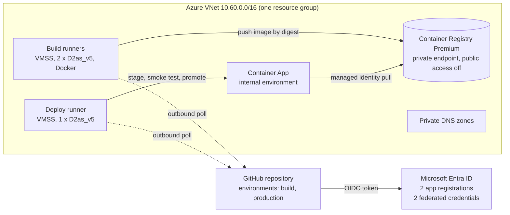

# POC: GitHub Actions to a private Azure Container App

A hands-on proof of concept for the [reference guide](../README.md). In about an hour of hands-on time you will deploy a small
private environment, wire GitHub to it with **OIDC (no Azure secret)**, and run a real release: build, approval, staged revision,
private smoke test, promotion, and rollback.

* **Option A (VMSS self-hosted runners)** is what this POC deploys. It is the guide's recommended starting point and needs no preview services.
* **Infrastructure** is Bicep in [infra/](infra). **Automation** is a short numbered script per step in [scripts/](scripts).
  Every script is optional: [infra/README.md](infra/README.md) shows the equivalent manual commands.

## Contents

1. [What you are proving](#1-what-you-are-proving)
2. [What gets built](#2-what-gets-built)
3. [Cost and time](#3-cost-and-time)
4. [Before you start](#4-before-you-start)
5. [Set up the POC](#5-set-up-the-poc)
6. [Run the POC: test scenarios](#6-run-the-poc-test-scenarios)
7. [Evidence checklist](#7-evidence-checklist)
8. [Day-to-day operations](#8-day-to-day-operations)
9. [Troubleshooting](#9-troubleshooting)
10. [Clean up](#10-clean-up)
11. [What this POC does not prove](#11-what-this-poc-does-not-prove)

## 1. What you are proving

| # | Claim | How the POC shows it |
|---|---|---|
| 1 | GitHub can deploy to Azure with **no stored Azure credential** | Entra federated credentials only; no client secret exists anywhere ([T1](#t1-first-release)) |
| 2 | Builds and deployments can reach a **private** registry and app | Registry public access is disabled and the app has no public endpoint ([T6](#t6-negative-security-checks)) |
| 3 | **Production needs approval**, and only from `main` | Required reviewer on the `production` environment ([T2](#t2-the-approval-gate)) |
| 4 | A bad release **cannot take production down** | A broken candidate is smoke-tested at zero traffic and rejected ([T4](#t4-a-broken-release-is-stopped)) |
| 5 | You can **roll back** quickly without rebuilding | Manual rollback workflow ([T5](#t5-roll-back)) |
| 6 | Pull requests **cannot reach Azure** | PR checks run on a GitHub-hosted runner with a read-only token ([T3](#t3-pull-request-checks)) |
| 7 | Each identity has **only the access it needs** | Build can push images; deploy can update one app; neither can do the other's job ([T6](#t6-negative-security-checks)) |

## 2. What gets built



| Piece | Created by | Notes |
|---|---|---|
| VNet, subnets, NAT gateway, NSG | [infra/modules/network.bicep](infra/modules/network.bicep) | NAT gives the runners explicit outbound access. No public IPs on VMs |
| Container Registry (Premium) | [infra/modules/registry.bicep](infra/modules/registry.bicep) | Private endpoint, public access disabled, admin user disabled, classic RBAC mode |
| Container Apps environment (internal) + Log Analytics | [infra/modules/containerapp-env.bicep](infra/modules/containerapp-env.bicep) | Internal load balancer, workload profiles, Consumption profile |
| Private DNS (registry zone, environment zone) | `registry.bicep`, [infra/modules/dns-aca.bicep](infra/modules/dns-aca.bicep) | Linked to the VNet so runners resolve private addresses |
| Container App `hello-poc` | [infra/modules/containerapp.bicep](infra/modules/containerapp.bicep) | Multiple-revision mode, port 8080, starts on a placeholder image |
| Pull identity (managed identity) | [infra/main.bicep](infra/main.bicep) | `AcrPull` on the registry only |
| Runner VMSS (build, deploy) | [infra/modules/runners.bicep](infra/modules/runners.bicep) | Ubuntu 24.04, SSH key only, no managed identity. Tools install at first boot |
| Entra apps, federation, roles | [scripts/02-entra-and-roles.sh](scripts/02-entra-and-roles.sh) | Entra objects are not created by Bicep |
| GitHub repository, environments, variables | [scripts/03-configure-github.sh](scripts/03-configure-github.sh) | No secrets are created |

**Differences from the production design in the guide** (deliberate, to keep the POC small and cheap):

| Guide | POC |
|---|---|
| 15 build + 2 deploy runners | 2 build + 1 deploy (set in `poc.env`) |
| Separate CI and production spokes | One VNet, separate subnets |
| Shared firewall, VPN, DNS resolver | NAT gateway only; you administer through Azure, not through a VPN or jump host |
| Existing, platform-owned ACR and ACA | Created here, so you can see exactly how they are configured |
| ACA Jobs runners and ACR Tasks pool (option B) | Not deployed. Add them later using guide section 7B |
| Application Gateway, auth, real app | Hello-world app |

## 3. Cost and time

* **Time:** about 15 minutes to deploy the infrastructure, 10 to register runners, and 10 for the first release. Allow roughly an hour for setup and another hour for the test scenarios.
* **Cost:** order of magnitude **$10 to $12 per day while everything runs**, using the list prices from the guide (East US, pay-as-you-go).
  Most of it is the three VMs (about $6), the Premium registry (about $1.70), and the NAT gateway (about $1.30). Deallocating the VMs when you are not testing saves about $6 a day ([section 8](#8-day-to-day-operations)). Deleting the resource group stops everything.
* These figures are estimates, not a quote. Set an Azure budget alert on the resource group before you start.

## 4. Before you start

### Accounts and permissions

| Need | Detail |
|---|---|
| Azure subscription | You need **Owner** (or Contributor plus User Access Administrator) on the subscription or resource group. Role assignments are part of the deployment |
| Entra permissions | Permission to create **app registrations** and federated credentials (for example the *Application Developer* role) |
| vCPU quota | 6 vCPUs of the DASv5 family in your region by default (3 VMs x 2). Request more if you raise the runner counts |
| GitHub account or organization | Permission to create a repository there, create environments, and set variables |
| **GitHub plan** | The reference repository is public, where required reviewers are available. Private repository feature availability depends on your plan; verify [GitHub's environment documentation](https://docs.github.com/en/actions/reference/workflows-and-actions/deployments-and-environments). Never remove the production approval gate to work around a plan limitation |
| A second GitHub account (optional) | Lets you test that a person cannot approve their own run. Without it, leave `GH_PREVENT_SELF_REVIEW=false` |

### Tools

A **Linux-style shell** with these tools. Azure Cloud Shell (Bash), WSL, macOS, and Git Bash on Windows all work.
The scripts talk to Azure only through its control plane, so **you do not need VPN or private network access**.

| Tool | Version | Check |
|---|---|---|
| Azure CLI | 2.60 or newer | `az version` |
| GitHub CLI (`gh`) | 2.40 or newer | `gh --version` |
| Git | any recent | `git --version` |
| curl | any | `curl --version` |
| jq | 1.6 or newer | `jq --version` |
| An SSH key pair | | `ssh-keygen -t ed25519` (the `.pub` file is passed to the VMs; there is no password login) |

The Bicep CLI is installed if missing by the first script. That script may also install/upgrade the Container Apps
extension and register resource providers; it is not read-only.

On Windows, run the POC commands in **Git Bash**, not PowerShell. Install missing tools from PowerShell:

```powershell
winget install --id Git.Git --exact
winget install --id Microsoft.AzureCLI --exact
winget install --id GitHub.cli --exact
winget install --id jqlang.jq --exact
```

Install only tools you do not already have, then close and reopen VS Code/Git Bash so PATH is refreshed.
Docker Desktop is not needed on your workstation: Docker runs on the build VMs.

Sign in to both CLIs before you begin:

```bash
az login                    # use --tenant <TENANT_ID> if you have several tenants
gh auth login               # choose GitHub.com and HTTPS; authorize repository and workflow access
gh auth status
```

### Get the files

```bash
git clone https://github.com/gregslack78/aca-github-actions-reference.git
cd aca-github-actions-reference/poc
```

The POC scripts expect the guide's `samples/` folder next to `poc/`, so use the whole repository.
If you already have this checkout, use it instead of cloning over it.

## 5. Set up the POC

Run every script from the `poc` folder. Review each step before running: these scripts create billable resources and change
GitHub/Entra access. Infrastructure reruns skip an existing app rather than resetting its image or traffic.
Other infrastructure settings still reconcile to the templates; review what-if before applying changes.

**This repository is also the deployment repository:** use `gregslack78/aca-github-actions-reference`, not a second empty repository.
The root CI workflow tests the app in `samples/` on hosted runners. Root release/rollback workflows use the same subdirectory
and are disabled until `DEPLOYMENT_ENABLED=true`. Do not copy the sample files over the repository root.
The example configuration is prefilled with this repository and reviewer `gregslack78`; Azure settings still need your input.

### Step 0. Configure `poc.env`

```bash
cp poc.env.example poc.env
```

Edit `poc.env`. It contains settings only, no secrets, and Git ignores it.

For Azure, run `az account list -o table` and select the intended subscription with
`az account set --subscription "<SUBSCRIPTION_ID>"`. Confirm `az account show --query "{name:name,id:id}" -o table`
before copying the ID. Do not rely on an old default subscription or old `.state` copied from another POC.
Check the public key exists with `test -f ~/.ssh/id_ed25519.pub`. If it does not, create a **new** key with
`ssh-keygen -t ed25519 -f ~/.ssh/id_ed25519`; do not overwrite an existing key. Only the `.pub` file is sent to Azure.
For a solo POC leave self-review prevention off; for real separation of duties name a second reviewer and enable it.

| Setting | What to enter |
|---|---|
| `SUBSCRIPTION_ID` | `az account show --query id -o tsv` |
| `LOCATION` | A region with `Standard_D2as_v5` quota and Container Apps. Default `eastus2` |
| `RESOURCE_GROUP` | Default `rg-aca-gh-poc`. The scripts create it |
| `POC_PREFIX` | 3 to 12 lowercase letters or digits. Used in resource names |
| `SSH_PUBLIC_KEY_FILE` | Path to your `.pub` key |
| `BUILD_INSTANCE_COUNT`, `DEPLOY_INSTANCE_COUNT` | Defaults 2 and 1. Raise the build count toward 15 to test the guide's concurrency target |
| `GH_OWNER` | `gregslack78` for this repository |
| `GH_REPO` | `aca-github-actions-reference` for this repository |
| `GH_REPO_VISIBILITY` | `private` or `public`. See the plan note in section 4 |
| `GH_REVIEWER` | GitHub login that must approve production deployments (can be you) |
| `GH_PREVENT_SELF_REVIEW` | `true` blocks the person who started a run from approving it. Use only with a second person |

Then check everything:

```bash
bash scripts/00-check-prereqs.sh
```

**What it does:** confirms the tools and both sign-ins, registers the Azure resource providers the POC needs, checks that the VM size is available and you have enough vCPU quota, and checks the SSH key, Entra access, and GitHub details.
**Expected:** a list of `[ ok ]` lines ending with `All checks passed`. Fix anything marked `[FAIL]` and run it again.

### Step 1. Deploy the infrastructure

```bash
az group create --name "<RESOURCE_GROUP_FROM_POC_ENV>" --location "<LOCATION_FROM_POC_ENV>"  # needed only for a first what-if
bash scripts/01-deploy-infra.sh --what-if   # optional: preview without deploying
bash scripts/01-deploy-infra.sh
```

**What it does:** creates the resource group when applying and deploys [infra/main.bicep](infra/main.bicep).
On the first deployment it waits for the placeholder revision and pins traffic to it.
If the app already exists, it passes `deployApp=false` and leaves the app's image, settings and traffic unchanged.
What-if never creates a resource group: it fails with instructions if the group does not exist.
**Time:** about 15 minutes.
**Expected:** a summary showing the registry login server, the private app URL, and the two scale sets. The values are saved in `.state/outputs.env` for the later steps.

Quick checks in the portal: the resource group contains a registry with a private endpoint, an internal Container Apps environment, two scale sets, and two private DNS zones.

### Step 2. Create the Entra identities and roles

```bash
bash scripts/02-entra-and-roles.sh
```

**What it does** (guide section 6, automated):

| Identity | Federated credential subject | Azure role |
|---|---|---|
| `gh-aca-poc-build` | `<sub_claim_prefix>:environment:build` | `Reader` and `AcrPush` on the registry |
| `gh-aca-poc-production` | `<sub_claim_prefix>:environment:production` | `Container Apps Contributor` on the one Container App |

The script obtains `sub_claim_prefix` from GitHub's OIDC policy API, including immutable owner/repository IDs when enabled.
It refuses to guess missing or custom policy. An existing credential with different claims still requires an explicitly
reviewed update; the script does not silently change trust.

There is **no client secret**: an attacker who copies the client ID gets nothing, because Entra only accepts a token that GitHub signs for that exact repository and environment.
**Expected:** the two client IDs. Role assignments can take a few minutes to take effect.

### Step 3. Configure GitHub

```bash
bash scripts/03-configure-github.sh
```

**What it does:**

1. Creates the repository if it does not exist (empty, no workflows yet).
2. Sets the default `GITHUB_TOKEN` permission to read-only and stops Actions from approving pull requests.
3. Creates the `build` and `production` environments, restricted to deployments from `main`. `production` requires your reviewer.
4. Sets every variable the workflows read, including the client IDs, registry, app name, and the runner labels ([guide section 4.3](../README.md#43-set-variables)).

**Expected:** a link to the environment settings. Open it and confirm the two environments, the `main`-only branch rule, and the reviewer.

### Step 4. Register the runners

```bash
bash scripts/04-register-runners.sh
```

**What it does:** fetches the latest runner version and its published checksum, then registers each VM as a service with the label `aca-build-vmss` or `aca-deploy-vmss`.
It runs inside each VM through `az vmss run-command`, waiting first for the first-boot tool install to finish, so it works without SSH or a VPN.
**Time:** about 2 minutes per VM.
**Expected:** each VM prints `REGISTER_OK`, and the final list shows every runner as `online`. You can also see them under the repository's **Settings > Actions > Runners**.

> The registration token is short-lived (one hour) and passed through the run command. It is not stored anywhere.

### Step 5. Publish the app and pipeline

For this reference repository, protect the already-published main branch **before enabling deployment**:

```bash
bash scripts/06-protect-repo.sh
```

In **Settings > Rules > Rulesets > protect-main**, check that pull requests are required and force pushes/deletion are blocked.
With a second reviewer, set `GH_REQUIRED_APPROVALS=1` and `GH_REQUIRE_CODE_OWNERS=true` before creating the ruleset.
The protection script reports an existing ruleset rather than overwriting it; edit existing rules in GitHub when changing policy.
For a public repository with private-network runners, only merge trusted code.

```bash
bash scripts/05-publish-pipeline.sh
```

**For this repository:** checks that the root release workflow exists, production has a reviewer, both environments allow
only `main`, and both runner pools have an online runner. It asks you to type the full repository name, then sets
`DEPLOYMENT_ENABLED=true` and dispatches the first release. No application files are copied or overwritten.
To pause future releases, use `gh variable set DEPLOYMENT_ENABLED --repo gregslack78/aca-github-actions-reference --body false`;
this does not cancel an already-running release.

**For a separate empty app repository:** retains the original seed behavior, copying portable app/pipeline files to its root,
adding the [repo-extras](repo-extras), and pushing the first commit. A nonempty non-reference repository is rejected.
**Expected:** a link to the Actions page. Continue with [T1](#t1-first-release).

### Step 6. Protect the repository

```bash
bash scripts/06-protect-repo.sh
```

**What it does:** applies the repository protection the guide recommends in [section 4.1](../README.md#41-repository-protection-recommended-owned-by-the-application-team).
For the reference repository run it before enabling releases as described above. For a separate empty app repository,
run it after seeding, because the ruleset blocks the initial direct push.

| Control | Setting |
|---|---|
| Ruleset `protect-main` on the default branch | Pull request required, force pushes blocked, branch deletion blocked, stale approvals dismissed on new pushes. Approvals required: `GH_REQUIRED_APPROVALS` (default `0` for a solo POC; use `1` or more when a second person works in the repo) |
| CODEOWNERS review | Off by default (`GH_REQUIRE_CODE_OWNERS=false`) because a person cannot approve their own pull request. Turn it on with a second reviewer |
| Actions policy | Only GitHub-owned actions plus `azure/login`; every action must be pinned to a full commit SHA |
| Outside contributors | Workflow runs from outside contributors need approval |
| Secret scanning + push protection | Enabled where your plan supports it |
| `GITHUB_TOKEN` | Read-only by default; Actions cannot approve pull requests (set in step 3) |

Anything your GitHub plan does not support is printed as `[skip]` with the reason, not silently ignored. Review the result at **Settings > Rules** and **Settings > Actions**.
Pipeline changes now go through pull requests, so merges in the scenarios below use `gh pr merge`.

### Step 7. Verify any time

```bash
bash scripts/07-verify.sh
```

**What it shows:** registry public access is disabled; the app is in multiple-revision mode with one revision at 100%; the app is **not** reachable from your machine; and from inside the VNet, on a build VM and a deploy VM, the tools, private DNS answers, and HTTPS to the private app all work.

## 6. Run the POC: test scenarios

Do these in order. Capture a screenshot or copy the output for each ([section 7](#7-evidence-checklist)).
Open the repository's **Actions** tab, and load your values in the shell you use for the commands below:

```bash
set -a; source poc.env; source .state/outputs.env; set +a
REPO="$GH_OWNER/$GH_REPO"
```

### T1. First release

Step 5 started it. Watch the **Build once and deploy immutable image** run.

1. The `build` job runs on a build VM. It runs the unit tests, signs in to Azure with OIDC, builds the image, pushes a tag such as `sha-<commit>-r<run>-a1`, and records the **digest**.
2. The `production` job then shows **Waiting for review**.

**Expected:** the build finishes green, and the run summary shows the image reference (`...azurecr.io/apps/hello@sha256:...`).
**Look for:** in the build job log, the Azure login step says it signed in with a federated token and shows no secret.

### T2. The approval gate

1. In the run, select **Review deployments**, tick `production`, and approve.
2. Watch the `production` job on the deploy VM: it rejects a stale commit, signs in with the **deploy** identity, creates a new revision with **no traffic**, waits for it to be healthy, smoke-tests its private URL, then moves 100% of traffic and re-tests.

**Expected:** the run finishes green. Check the revisions:

```bash
az containerapp revision list -n "$ACA_APP" -g "$RESOURCE_GROUP" \
  --query '[].{revision:name,traffic:properties.trafficWeight,image:properties.template.containers[0].image}' -o table
```

You should see the new revision at 100% and the bootstrap revision at 0%. The step summary lists the previous and candidate revisions. **Write down the candidate revision name**: it is your rollback target in T5.

**Also try:** run the workflow from another branch (**Run workflow** with a branch other than `main`). The `production` job must not start, because the environment only allows `main`.

### T3. Pull request checks

1. Create a branch, make a harmless change, and open a pull request:

```bash
git clone "https://github.com/$REPO.git" && cd "${REPO#*/}"
git switch -c pr-test
echo "# pr check test" >> samples/app/server.py
git commit -am "PR check test" && git push -u origin pr-test
gh pr create --fill
```

2. The **Unprivileged pull request checks** workflow runs on a **GitHub-hosted** runner.

**Expected:** the unit tests pass and the container build is verified. Open the job log and confirm that it ran on `ubuntu-24.04` (not one of your VMs) and that no Azure sign-in step ran.
Close the pull request without merging, so it does not start a release: `gh pr close pr-test --delete-branch`.

### T4. A broken release is stopped

1. On a new branch, change the `APP_COMMIT` environment value in `samples/Dockerfile` from `${APP_COMMIT}` to `broken-poc-commit`.
   Do not change the source or tests. This deliberately makes the built image report the wrong release commit.
2. Open a pull request. The source HTTP tests and image build still pass, but the deployed image will fail commit verification. Merge it.
3. The release builds and, after you approve, the deploy job creates a candidate revision, tries to smoke-test it, and **fails**.

**Expected:** the production job fails, and 100% of traffic is **still on the previous good revision**. Check with the revision list above.
Then fix the problem (revert the change), merge, and approve again to get a good release.

For a separate seeded app repository, omit the `samples/` prefix in file paths throughout these scenarios.

### T5. Roll back

You need at least two good revisions created by releases (the bootstrap placeholder cannot be used because it does not serve the app's `/health` message).
After T2 and the repaired release from T4 you have two.

1. Run the rollback workflow, using the revision name you wrote down in T2:

```bash
gh workflow run rollback.yml --repo "$REPO" --ref main -f revision=hello-poc--gha<RUN_ID>a1
```

2. Approve the `production` job.

**Expected:** the script activates the revision, tests it privately, moves 100% of traffic to it, and verifies the stable URL. There is no rebuild. The `/health` commit value now matches the older release.

### T6. Negative security checks

Each of these should **fail**. Failing is the pass condition.

| # | Check | How | Expected |
|---|---|---|---|
| a | The registry is not public | From your own machine: `az acr login -n "$ACR_NAME"` | Fails: the registry denies public network access |
| b | The app is not public | `curl --max-time 10 "https://$ACA_APP_FQDN/health"` from your machine | Fails to resolve or connect |
| c | Both resolve privately from inside the VNet | `bash scripts/07-verify.sh` | DNS answers are `10.60.x.x` addresses and `status=200` |
| d | Build identity cannot change the app | `az role assignment list --assignee "$BUILD_CLIENT_ID" --all -o table` | Only `Reader` and `AcrPush`, scoped to the registry |
| e | Deploy identity cannot push images | `az role assignment list --assignee "$DEPLOY_CLIENT_ID" --all -o table` | Only `Container Apps Contributor`, scoped to the one app |
| f | No stored Azure secret | Repository **Settings > Secrets and variables > Actions** and each environment | No secrets listed |
| g | Production only from `main` | Run `release.yml` from a non-`main` branch (see T2) | The `production` job does not run |
| h | Runners are not exposed | `az vmss list-instance-public-ips -g "$RESOURCE_GROUP" -n "$BUILD_VMSS"` | No public IPs returned |

### T7. Optional: concurrency

The guide targets 10 to 15 simultaneous builds. To try it, set `BUILD_INSTANCE_COUNT=15` in `poc.env` (check vCPU quota: 30 for builds), run
`bash scripts/01-deploy-infra.sh` then `bash scripts/04-register-runners.sh`, and trigger several runs of `release.yml` with **Run workflow**.
Measure the queue-to-start time and build duration. Deploy jobs are serialized by design: only the latest `main` commit reaches production.

## 7. Evidence checklist

Use this as the sign-off record for the customer.

| # | Evidence | Done |
|---|---|---|
| 1 | Screenshot: both environments, with `main`-only branch rule and the reviewer | [ ] |
| 2 | Screenshot or text: both Entra federated credentials and their subjects (no secrets tab entries) | [ ] |
| 3 | T1 build log: OIDC login, image digest in the summary | [ ] |
| 4 | T2: approval screen, then revision list showing 100% on the new revision | [ ] |
| 5 | T3: PR check log showing a hosted runner and no Azure step | [ ] |
| 6 | T4: failed production job and revision list proving traffic never moved | [ ] |
| 7 | T5: rollback run and the `/health` commit before and after | [ ] |
| 8 | T6: output of every negative check | [ ] |
| 9 | `07-verify.sh` output, from inside the VNet | [ ] |
| 10 | Measured numbers: build duration, queue-to-start, first-release time end to end | [ ] |

## 8. Day-to-day operations

| Task | Command |
|---|---|
| Stop paying for runner VMs overnight | `az vmss deallocate -g "$RESOURCE_GROUP" -n "$BUILD_VMSS"` and the same for `$DEPLOY_VMSS`. Disks still bill |
| Start them again | `az vmss start -g "$RESOURCE_GROUP" -n "$BUILD_VMSS"` and the same for the deploy set. Registrations persist |
| Reach a runner VM | There is no SSH path by design. Use `az vmss run-command invoke --command-id RunShellScript --scripts "<command>"`, or add Azure Bastion |
| Runner logs | In the VM: `journalctl -u 'actions.runner.*'`; first-boot log: `/var/log/poc-provision.log` |
| Update the runner software | Re-register after drain; GitHub requires regular runner updates |
| App logs | `az containerapp logs show -n "$ACA_APP" -g "$RESOURCE_GROUP" --type console --tail 50` |
| Re-run a failed step | Every script is safe to repeat |

Load your values first with `set -a; source poc.env; source .state/outputs.env; set +a` (see the start of [section 6](#6-run-the-poc-test-scenarios)).

## 9. Troubleshooting

| Symptom | Likely cause and fix |
|---|---|
| `00-check-prereqs.sh`: SKU not available or quota | Choose another `VM_SIZE` or `LOCATION`, or request vCPU quota |
| Deployment fails on the registry or Container Apps | Resource providers not registered: rerun step 0. Container Apps environments also need the subnet to be unused and delegated |
| Step 3: cannot create environment or reviewers | Private repository on a free plan. Use a public repository, or upgrade the plan |
| Step 4: `REGISTER_OK` never appears | Tool install failed. The script prints the last lines of `/var/log/poc-provision.log`. Usually missing outbound access: check the NAT gateway and subnet association |
| Step 4: cannot read the runner checksum | Open the [runner releases](https://github.com/actions/runner/releases), copy the version and linux-x64 SHA-256, and register by hand with [samples/scripts/install-vm-runner.sh](../samples/scripts/install-vm-runner.sh) |
| Job waits forever for a runner | Runner label mismatch with the `BUILD_RUNNER_LABELS` / `DEPLOY_RUNNER_LABELS` repository variables, or runners offline (VMs deallocated) |
| `AADSTS70021`, no matching federated credential | Compare the real subject with the credential. The default is `repo:<owner>/<repo>:environment:<name>`; some repositories use immutable-ID subjects. Add the optional [oidc-inspect.yml](../samples/.github/workflows/oidc-inspect.yml) to see exactly what GitHub sends, then update the credential |
| `AuthorizationFailed` right after step 2 | Role assignments need a few minutes. Re-run the workflow |
| `az acr login` or image push fails from the build VM | Check private DNS: `getent ahostsv4 <registry>.azurecr.io` must return a `10.60.x.x` address. Run `07-verify.sh` |
| Deploy: "Require one explicit revision at 100%" | Traffic is set to `latest`. Re-run the pinning command from step 1 for the current revision |
| Deploy: revision never becomes healthy | `az containerapp logs show ... --type system`. Check the registry pull (managed identity, DNS) and that the image listens on 8080 |
| Smoke test fails with 404 | App ingress must stay `external` on this internal environment; do not set it to `internal` |
| Rollback fails on the bootstrap revision | Expected: the placeholder does not serve the app's `/health`. Roll back to a revision created by a release |

## 10. Clean up

```bash
bash scripts/99-teardown.sh
```

It deletes only the two recorded Entra client IDs and the resource group (in the background).
It refuses to guess identities by display name if saved client IDs are missing. It does **not** delete the GitHub repository.
Keep this reference repository; remove offline runner entries and disable deployment when dismantling the POC.
Confirm deletion finished with `az group exists --name "$RESOURCE_GROUP"` and check Cost Management afterward.

## 11. What this POC does not prove

* Behavior at the guide's full scale (15 build runners) unless you run T7.
* **Option B** (ACA Jobs runners with an ACR Tasks agent pool). That path has preview components and a separate cost; evaluate it after this one succeeds using guide section 7B.
* Production network design: separate spokes, firewall egress control, VPN or ExpressRoute access, and customer DNS integration.
* An ABAC-mode registry. This POC uses classic RBAC; see the ABAC note in guide section 6.2.
* Operational readiness: runner patching, image refresh, alerting, backup of rollback images, and cost budgets.
* Application concerns such as authentication, data, and a real workload.

Record what you learn, then use [guide section 11](../README.md#11-security-notes-and-what-is-not-covered) to plan the production hardening.
